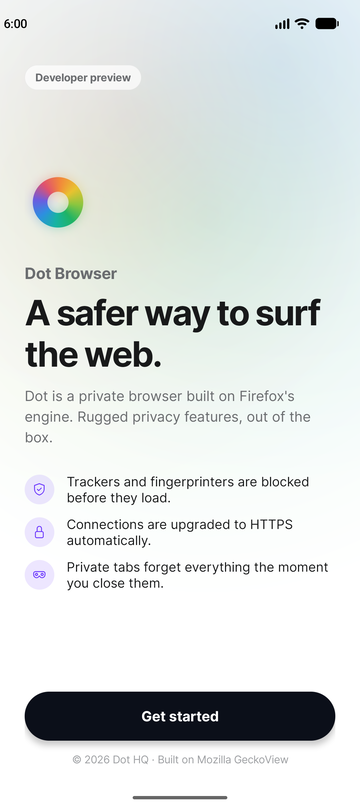
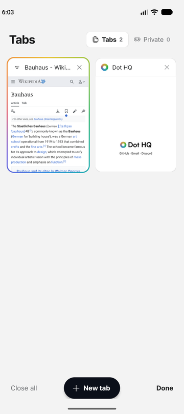
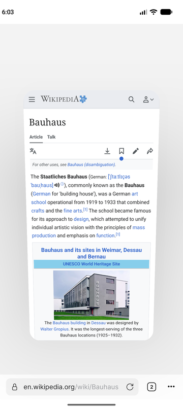
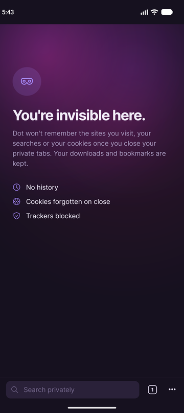

# Dot Browser for Android

The same private browser you all know and love, rebuilt for Android in the Dot design language. Built on [GeckoView](https://mozilla.github.io/geckoview), Firefox's engine.

<p>
  
  
  
  
</p>
<p>
  
  
  
  
</p>

## What's inside

**A normal browser, done properly.** Tabs (restored after restarts, drag to reorder, swipe to close, undo), private tabs, history and bookmarks, find in page, desktop site, downloads, screenshots, view source, a link peek with live previews, pull to refresh, page permissions and prompts, and an address bar that searches, suggests and switches tabs.

**Private by default.** Strict Enhanced Tracking Protection, HTTPS-Only mode, Global Privacy Control, tracking parameters stripped from links, and cross-site cookies isolated per site. The purple shield in the address bar counts trackers stopped on the page; tap it for the breakdown. The new tab page keeps the lifetime total.

**The Dot design language.** The toolbar, the menu (with its navigation row and inset separators) and the tab cards are translated from desktop Dot. Icons come from the Dot icon set, with new ones drawn in the same style in [`design/icons`](design/icons). Light, dark and a deep-violet private palette; toolbar at the bottom or, like desktop, at the top.

**Something a little different.**
- Pages load with a halo: the address field's outline fills with the Dot ring gradient, then blooms.
- Everything comes from somewhere. The page unwinds into its card in the tab grid and expands back out of it; new tabs grow from the button you pressed; swiped-away pages slide the way you swiped; closed tabs shrink into the tab counter; links opened in the background fly into it.
- Pull the address bar into the page (down from the top, up from the bottom) and the page tilts back in 3D on its way to the tab grid.
- A haptic vocabulary: ticks, taps, confirmations, a thud for long-presses, a double-tap for closing, a spin for the ring.
- A living ring and a barely-there aurora on the new tab page. Long-press the ring.

## Building

Requires JDK 17+ and the Android SDK (API 37.2 platform; Gradle fetches it if licences are accepted).

```bash
./gradlew assembleDebug
```

The APK lands in `app/build/outputs/apk/debug/`. Unit tests: `./gradlew testDebugUnitTest`.

## Layout

| Path | What |
| --- | --- |
| `app/src/main/java/co/dothq/browser/tabs` | `TabManager` owns every `GeckoSession`; app-scoped, so tabs survive the window |
| `app/src/main/java/co/dothq/browser/ui` | The Dot UI kit, toolbar, menu, sheets, tab grid, new tab page, transitions, signature visuals |
| `app/src/main/java/co/dothq/browser/gecko` | Prompts and permissions |
| `app/src/main/java/co/dothq/browser/core` | Preferences, URLs and search engines, history/bookmarks, favicons, downloads, error pages |
| `design/icons` | Source SVGs for every icon |

<a href="https://play.google.com/store/apps/details?id=co.dothq.browser" target="_blank">
  
</a>

## ❗ Issues / Support

You can create issues [here](https://github.com/dothq/browser/issues/new) or get support from our discord server, which you can join by clicking the banner below.

<a href="https://invite.gg/dot">
  
</a>

## ❤️ Acknowledgements

-   Dot Browser wouldn't be possible without the amazing [Firefox open-source project](https://hg.mozilla.org/mozilla-central/), developed by [Mozilla](https://mozilla.org).

## 🤝 Contributors

-   [ejaz4](https://github.com/ejaz4) - **_Main Developer_**
-   [EnderDev](https://github.com/EnderDev) - **_Main Developer_**

## 💸 Donations

We accept donations on [Liberapay](https://liberapay.com/dothq) or [Patreon](https://patreon.com/dothq) to keep our servers running.

## 📜 License

**Dot Browser for Android** is licensed under the [MPL-2.0](https://www.mozilla.org/en-US/MPL/2.0) license.
